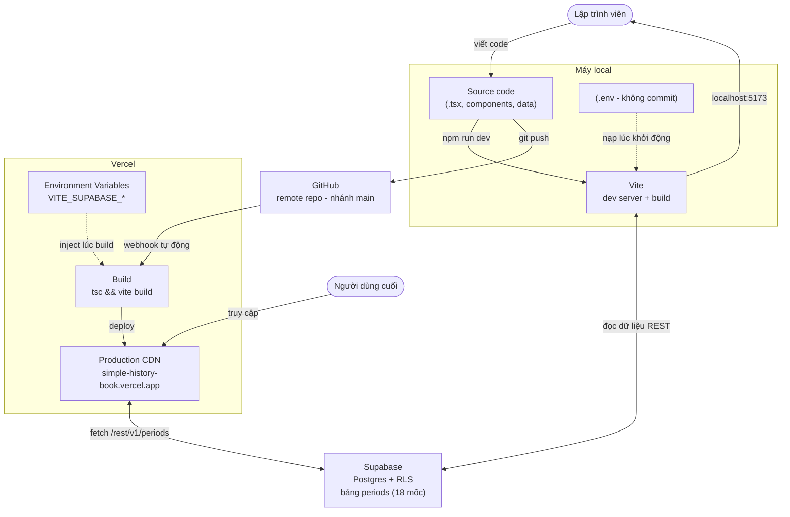

# Simple History Book

Website tra cứu các triều đại và thời kỳ lịch sử Việt Nam, từ nhà nước Văn Lang,
Âu Lạc, trải qua các triều đại phong kiến và những cuộc chiến tranh vệ quốc cho
đến nay. Trang chủ hiển thị mỗi thời kỳ là một dấu mốc trên dòng thời gian nằm
ngang; bấm vào một mốc để xem trang chi tiết của triều đại đó.

**Demo:** <https://simple-history-book.vercel.app/>

## Công nghệ

- **React + TypeScript** — giao diện
- **Vite** — dev server và build
- **React Router** — điều hướng trang chủ / trang chi tiết
- **Supabase** — cơ sở dữ liệu Postgres lưu các triều đại (có fallback dữ liệu tĩnh)
- **Vercel** — hosting và deploy tự động

## Kiến trúc & luồng deploy



Ba luồng chính:

- **Phát triển:** viết code → `npm run dev` chạy Vite (nạp `.env`) → xem ở `localhost:5173`, đọc dữ liệu thẳng từ Supabase.
- **Deploy:** `git push` lên `main` → GitHub bắn webhook → Vercel build (env var inject lúc build) → deploy lên CDN.
- **Runtime:** trình duyệt người dùng fetch trực tiếp tới Supabase REST API để lấy dữ liệu.

## Chạy ở local

```bash
# 1. Cài dependencies
npm install

# 2. Tạo file .env từ mẫu rồi điền giá trị thật
cp .env.example .env

# 3. Chạy dev server
npm run dev
```

Mở <http://localhost:5173/>. Footer trang chủ cho biết nguồn dữ liệu đang dùng là
"Supabase" hay "nội bộ" (dữ liệu tĩnh).

### Biến môi trường

Khai báo trong `.env` ở local, và trong Vercel → Settings → Environment Variables
khi deploy. Tên biến phải bắt đầu bằng `VITE_` thì Vite mới đưa ra trình duyệt.

| Biến | Mô tả |
|------|-------|
| `VITE_SUPABASE_URL` | URL gốc của project Supabase, ví dụ `https://xxxx.supabase.co` (không kèm `/rest/v1/`) |
| `VITE_SUPABASE_ANON_KEY` | Anon public key (Dashboard → Project Settings → API) |

> Nếu không cấu hình hai biến này, ứng dụng tự fallback về dữ liệu tĩnh trong
> `src/data/periods.ts`.

## Scripts

| Lệnh | Tác dụng |
| ------ | ---------- |
| `npm run dev` | Chạy dev server (Vite) |
| `npm run build` | Kiểm tra kiểu (`tsc --noEmit`) rồi build production |
| `npm run preview` | Xem thử bản build |
| `npm run lint` | Chạy ESLint |

## Cơ sở dữ liệu (Supabase)

Hai script SQL trong thư mục `supabase/`, chạy trong Supabase → SQL Editor:

- `schema.sql` — bảng `periods` (18 triều đại) + RLS + policy đọc công khai.
- `events.sql` — bảng `events` (các mốc sự kiện trong từng triều đại), tham chiếu
  `periods.id` qua khóa ngoại. **Chạy sau `schema.sql`.**

Cả hai dùng `on conflict ... do update` nên chạy lại nhiều lần an toàn (idempotent).

Nếu chưa tạo bảng, ứng dụng tự fallback về dữ liệu tĩnh trong `src/data/`
(`periods.ts` và `events.ts`), nên web vẫn chạy đầy đủ.

### Cập nhật sự kiện tự động

`src/data/events.ts` là nguồn gốc dữ liệu sự kiện. Sau khi sửa file này, đồng bộ
lên bảng `events` của Supabase bằng:

```bash
npm run seed:events
```

Script `scripts/seed-events.mjs` upsert toàn bộ sự kiện (không trùng lặp nhờ khóa
`period_id,id`). Script cần `SUPABASE_SERVICE_ROLE_KEY` trong `.env` — key quản trị
này **chỉ dùng ở local**, không đưa vào frontend và không commit.

## Tối ưu bundle

Các trang (`Home`, `PeriodDetail`, `EventDetail`) được nạp bằng `React.lazy`
(route-based code splitting), nên thư viện Supabase được tách thành chunk riêng
và chỉ tải khi cần, giúp bundle khởi động nhỏ hơn.

## Deploy (Vercel)

Project kết nối với GitHub. Mỗi lần push lên nhánh `main`, Vercel tự build và
deploy lại production. File `vercel.json` cấu hình rewrite SPA để các route con
(ví dụ `/period/ly`) không bị 404 khi tải lại trang.

## Cấu trúc thư mục

```
src/
  components/   # Timeline (dòng thời gian ngang)
  pages/        # Home, PeriodDetail, EventDetail (lazy-loaded)
  hooks/        # usePeriods, useEvents (nạp từ Supabase, fallback dữ liệu tĩnh)
  lib/          # khởi tạo Supabase client
  data/         # dữ liệu tĩnh: periods.ts (triều đại), events.ts (sự kiện)
supabase/
  schema.sql    # bảng periods + RLS + seed
  events.sql    # bảng events + RLS + seed
vercel.json     # rewrite SPA
```
